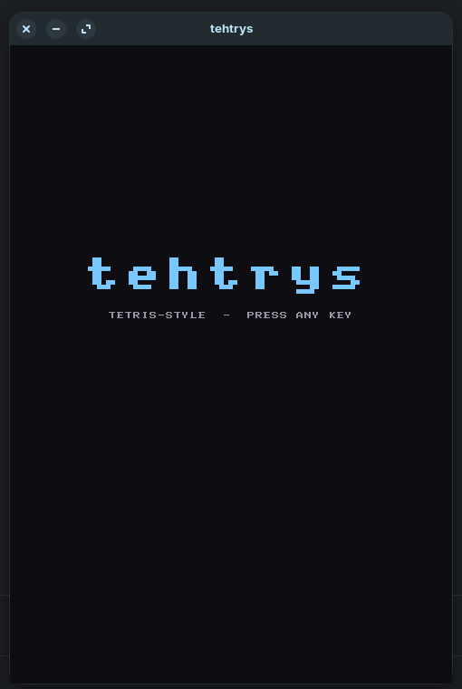
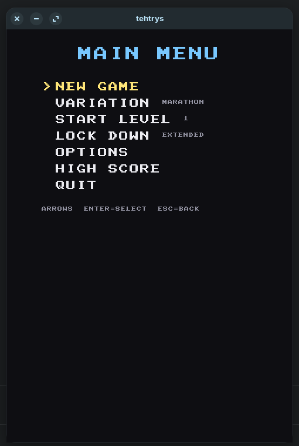
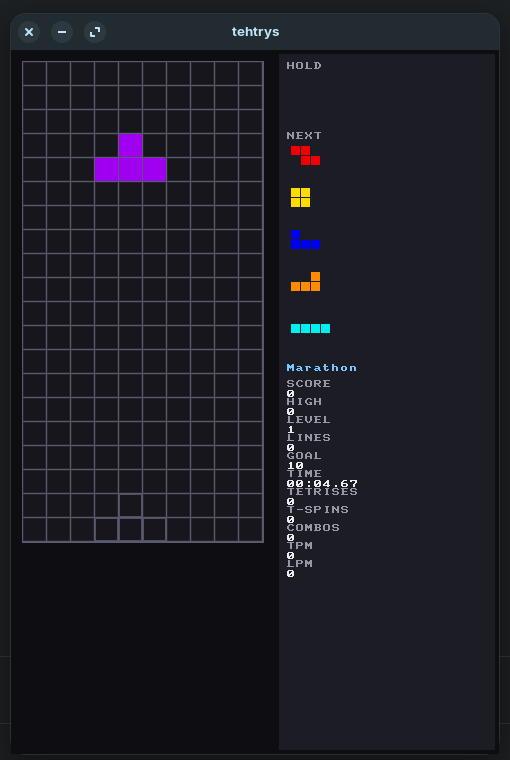
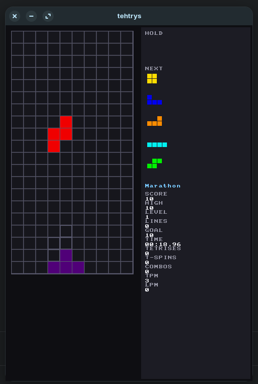

# tehtrys

A **Tetris** game in Rust (edition 2024), built to faithfully implement the official
**2009 Tetris Design Guideline** mechanics. **Phases 0-5 done**: pure deterministic core engine + SDL2 desktop shell + full
presentation + variants/persistence + sound/remapping/replay. See [`docs/plan/`](docs/plan/README.md).

> ## ⚠️ Disclaimer
>
> This work is provided **purely for educational and study purposes** — to learn
> Rust, game design, and the published Tetris gameplay rules — and is **never for
> commercial use**. See [LICENSE](LICENSE).
>
> - Not affiliated with, endorsed by, or licensed by **The Tetris Company** /
>   Tetris Holding, LLC. "Tetris®" is a registered trademark; no trademark or
>   protected-asset rights are claimed or granted.
> - Gameplay mechanics are implemented from the published rules in the included
>   **2009 Tetris Design Guideline** PDF; no proprietary artwork, audio, or marks
>   are reproduced. A commercial/official product would require separate licensing.

## License

**Free to use for non-commercial + educational purposes** under
**[CC BY-NC 4.0](LICENSE)** (attribution; **no commercial use**). See [LICENSE](LICENSE).

## What this is

- **`core`** (`src/core/`): pure, deterministic, headless-testable Tetris engine —
  no rendering, OS, wall-clock, or external-crate dependencies.
  - 10×20 matrix + 20-row buffer zone; 7 tetriminos; North-facing spawn;
  - **Super Rotation System** (5 kicks, T exceptions, O/I/3×3);
  - **7-bag** randomization + Next queue; **Hold** (once/lock); **Ghost** data;
  - **Lock Down**: hard-drop instant + 0.5 s; **Extended** (default)/**Infinite**/
    **Classic**; A1.2.3 surface tracking;
  - **scoring**: line clears, **T-Spin/Mini**, **Back-to-Back**, soft/hard drop;
  - **levels 1–15** + Fixed/Variable goals + fall-speed curve;
  - **game over**: Lock Out / Block Out / Top Out (seam);
  - **8 engine phases** (A1.2); **variants**: Marathon / Sprint / Ultra;
  - deterministic (seedable PRNG; integer ms; injectable time).
- `#![forbid(unsafe_code)]`.

## Screenshots

| | |
|---|---|
| **Opening / title**<br> | **Main menu**<br> |
| **Gameplay**<br> | **Gameplay**<br> |

## Build & test

```sh
cargo build
cargo test          # 117 tests (101 lib + 16 integration; guideline-derived)
cargo clippy --all-targets -- -D warnings
cargo fmt --check
```

### Requirements

- **Rust toolchain 1.100+** (edition 2024).
- **SDL2** system library. **Not** `sdl2_mixer` and **not** `sdl2_ttf`: sound uses
  SDL2 *built-in* audio (original procedural synth); UI text uses an embedded
  8×8 font. A pure-Rust core needs no system libs; only SDL2 must be findable.

### Cross-platform: no source changes needed

`core` is pure Rust; `app`/`render`/`sound` only use the `sdl2` crate. Building on
**macOS** or **Windows** needs **no code changes** — only the **system SDL2
library + linker environment** differs. `#![forbid(unsafe_code)]`; no unsafe.

This repo ships `.cargo/config.toml` with `[env] LIBRARY_PATH` /
`LD_LIBRARY_PATH = /home/linuxbrew/.linuxbrew/lib` **for this Linux box only**;
`force = false`, so real environment variables win. On **macOS/Windows remove or
override that block** (it injects a harmless nonexistent `/home/linuxbrew/...`
path but won't find SDL2 for you).

#### Linux (Debian/Ubuntu)

```sh
sudo apt install libsdl2-dev        # Fedora: SDL2-devel; Arch: sdl2
cargo run
```

`cargo test` needs SDL2 linkable even without a display; `sdl2` crate ships
bindings. `cargo test` does not need `libsdl2-dev` at *test-runtime* but does at
link-time.

#### macOS

```sh
brew install sdl2                   # https://brew.sh
cargo run
```

Homebrew prefix `/opt/homebrew` (Apple Silicon) or `/usr/local` (Intel). If the
linker can't find SDL2:

```sh
export LIBRARY_PATH="$(brew --prefix sdl2)/lib:${LIBRARY_PATH}"
export DYLD_FALLBACK_LIBRARY_PATH="$(brew --prefix sdl2)/lib:${DYLD_FALLBACK_LIBRARY_PATH}"  # runtime
```

Remove the committed linuxbrew `[env]`. macOS runtime uses `DYLD_*`, not
`LD_LIBRARY_PATH`. App bundling not covered. `cargo test` works headless;
sound headless `SDL_AUDIODRIVER=dummy`. **Not verified on macOS in this env.**

#### Windows

1. Install **SDL2 development binaries** (e.g. `SDL2-devel-2.x-VC.zip` /
   `-mingw` from libsdl.org). No header needed (`sdl2` crate ships bindings).
2. Put `SDL2.dll` next to `target\debug\tehtrys.exe` (and `target\release\...`)
   **and** on `PATH`.
3. Point the linker at `SDL2.lib`:
   - **MSVC (`x86_64-pc-windows-msvc`):** `set LIB=C:\SDL2\lib\x64;%LIB%` and
     `set PATH=C:\SDL2\lib\x64;%PATH%`. (`LIBRARY_PATH`/`LD_LIBRARY_PATH`
     are ignored by the MSVC linker.)
   - **MinGW (`x86_64-pc-windows-gnu`):**
     `set LIBRARY_PATH=C:\SDL2-mingw\x86_64-w64-mingw32\lib;%LIBRARY_PATH%`
     + `PATH`; SDL2 mingw also ships `SDL2main`. 
4. **Remove the committed linuxbrew `[env]`** in `.cargo/config.toml` (Unix paths).
5. `cargo run`. 

No source changes. (Alternatively enable `sdl2`'s `bundled` feature to vendor
SDL2 — **not enabled** here.) `cargo test` needs SDL2 linkable; `cargo test`
itself doesn't open a window; `cargo run` needs a display. **Not verified on
Windows in this env.**

### Portability notes

- `.cargo/config.toml` `[env]` is **machine-specific**; committed only for this
  Linux box; `force=false`.
- **Persistence** (`tehtrys_settings.txt`, `tehtrys_scores.txt`,
  `tehtrys_replay.txt`, `music/`): `~/.local/share/tehtrys`. Uses `$HOME`.
  - **macOS:** `$HOME` set → `~/.local/share/tehtrys`. 
  - **Windows:** `$HOME` often **unset** → falls back to `%TEMP%\tehtrys`; 
    `USERPROFILE`/`APPDATA` are **not** currently checked. (No code change
    *needed* to build; persistence location differs.)
- Pure core, `forbid(unsafe_code)`, no extra deps → `core` portable everywhere.
- Sound/music no licensed assets; optional `korobeiniki.wav`; works without an
  audio device (`NullAudio` fallback; `SDL_AUDIODRIVER=dummy`).

## Docs

- [docs/plan/README.md](docs/plan/README.md) — complete plan, phases, flows, appendices.
- Source rules: the **2009 Tetris Design Guideline** (© Blue Planet Software;
  CONFIDENTIAL; "Tetris®"). **Not distributed in this repo**; kept **local-only**
  and git-ignored (`docs/2009 Tetris Design Guideline.pdf`, plus optional local
  restatement). Mechanics are restated in my own `docs/plan/`.

## Status

Implementation progress by phase. Commit ids link to this repo's `master`. See
[docs/plan/07-phases.md](docs/plan/07-phases.md) for full detail.

| Phase | Scope | State | Commit |
|-------|-------|-------|--------|
| **0 — Scaffolding** | Cargo layout; `#![forbid(unsafe_code)]`; fmt/clippy/test wired; `sdl2` kept; `cgmath` removed; `core` zero external deps | done | [`6f0c2d5`](https://github.com/d-subrahmanyam/rust-tehtrys/commit/6f0c2d5) |
| **1 — Pure core engine** | 10×20+20 buffer; 7 pieces; North; SRS + kicks + T-spin/Point-5; 7-bag + seedable PRNG; Lock-Down (Extended/Infinite/Classic; 0.5 s); scoring + B2B; levels 1-15 + Fixed/Variable goals; game-over (LockOut/BlockOut/TopOut seam); 8 phases; Marathon/Sprint/Ultra shells; 86 tests | done | [`6f0c2d5`](https://github.com/d-subrahmanyam/rust-tehtrys/commit/6f0c2d5) |
| **2 — SDL2 shell + input** | SDL2 window; fixed 60 Hz accumulator + dt clamp; keymap §4.1; own DAS/ARR; edge vs level; ignore SDL repeat; pause; focus auto-pause; restart; minimal render; event hooks | done | [`fb8571b`](https://github.com/d-subrahmanyam/rust-tehtrys/commit/fb8571b) |
| **3 — Full presentation** | §2.4.7 HUD; Next 1-6; Hold; Ghost; colors; action notifications §13.1.5; line-clear + lock flash + hard-drop trail + level-up; Pause §13.1.6; Game Over; scaling; monochrome §3.2 (`M`); embedded 8×8 font (no `sdl2_ttf`); menu shells | done | [`40f4d41`](https://github.com/d-subrahmanyam/rust-tehtrys/commit/40f4d41) |
| **4 — Variants, progression, persistence** | app state machine §2 + menus; Marathon/Sprint-40/Ultra-2:00; start level 1-15; Lock-Down mode §2.5.4; Next-length §2.5.1; Hold/Ghost toggles §2.5; Fixed/Variable goals §6; **high-score table** §11.2 + **settings persistence** (custom text, no serde); Game Over; end-rewards seam; 98 tests | done | [`7bcd4bb`](https://github.com/d-subrahmanyam/rust-tehtrys/commit/7bcd4bb) |
| **5 — Polish** | **sound effects** §13.2 (`Audio` trait; procedural synth; no licensed assets; volume/toggle; mute); **music slot Korobeiniki §13.3** (no licensed asset; optional user WAV); **key remapping** §4.1 UI + persisted; settings robustness + atomic write; **seeded randomness** + **replay/determinism**; **high-score name entry** §11.2; **help + scoring demo + credits** §2.6/§8; **demo**; robustness; 117 tests | done | [`f087754`](https://github.com/d-subrahmanyam/rust-tehtrys/commit/f087754) |
| **6 — Multiplayer seams** *(optional, not v1, **document-only**; **not built**)* | guideline Appendix B restated (line attack, counter attack, receiving queue, broken/solid, 8-line gap, Top Out §10.5, Extended §5.7, shared 7-bag order, practice, UI) + seams already in pure `core`; no multiplayer gameplay/networking | done (docs) | [`699423f`](https://github.com/d-subrahmanyam/rust-tehtrys/commit/699423f) |

### Cross-cutting status

| Item | Status | Commit |
|------|--------|--------|
| fmt/clippy(`-D warnings`)/test clean | ✅ (117 tests) | [`f087754`](https://github.com/d-subrahmanyam/rust-tehtrys/commit/f087754) |
| `#![forbid(unsafe_code)]` | ✅ | [`6f0c2d5`](https://github.com/d-subrahmanyam/rust-tehtrys/commit/6f0c2d5) |
| `core` pure / no rendering / no OS / no wall-clock / no external deps | ✅ | [`6f0c2d5`](https://github.com/d-subrahmanyam/rust-tehtrys/commit/6f0c2d5) |
| Headless `cargo run` (dummy video/audio drivers) | ✅ smoke | [`f087754`](https://github.com/d-subrahmanyam/rust-tehtrys/commit/f087754) |
| Reference source not distributed (git-ignored, not in history) | ✅ | [`a9b766e`](https://github.com/d-subrahmanyam/rust-tehtrys/commit/a9b766e) |

### Honest notes

- **Not pixel-verified** (headless env); HUD/menus use embedded font; layout not screenshot-checked.
- **Audio not verified audibly** in headless env; synth + event→cue mapping + WAV parsing are unit-tested; **no protected audio shipped**; `Korobeiniki` slot only plays a *user-supplied* `korobeiniki.wav`.
- Phase-5 plan named `sdl2_mixer`, but that **system library isn't available here**; implemented `Audio` trait + procedural synth on **SDL2 built-in audio** (no extra dependency). 
- High-score name entry, sound volumes, key remapping, seed, replay are **persisted** under `~/.local/share/tehtrys`. 
- `restart` reuses current seed (deterministic); random-seed mode + replay supported.
- **Not legal advice.**
