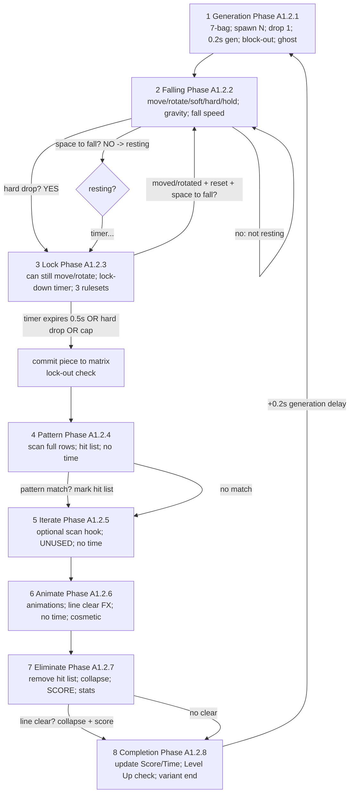

# Flow 02 — The Eight Engine Phases

Guideline **A1.1 Tetris Engine Flowchart** + **A1.2**. Only one tetrimino at a time;
each piece traverses eight phases in order. **Pattern, Iterate, Animate take no
apparent game time** (A1.2.4–6).

(This mirrors the guideline's A1.1 flowchart wording: Falling→Lock→Pattern…; Hard
Drop short-circuits to Lock; Moved?/Space-to-fall?/Reset-Lock-Down-Timer? branches;
Pattern match → mark; Line Clear? → Eliminate; Completion → Generation.)

## Phase contracts

### 1 Generation (A1.2.1)
- Inputs: bag front; previous Completion done + **0.2 s** elapsed.
- 7-bag shuffle/refill (§3.3); spawn **North** on rows 21/22 → engine rows 18/19; §3.4
  placement; **drop one row if clear**; immediate manipulation; ghost; **Block Out**
  check (§10.7).
- Fill Next Queue tail; track one piece forward (§3.3).
- → Falling.

### 2 Falling (A1.2.2)
- Player actions (§4/§5): move, rotate, soft, hard, hold; gravity at `fall_ms(level)`
  (§7); generated piece already dropped one.
- → Lock when resting; hard drop → Lock immediately.

### 3 Lock (A1.2.3)
- Same actions allowed until locked; **0.5 s** timer; three rulesets (§5.7–5.9);
  hard-drop instant; **A1.2.3 lift-off** semantics; re-enter Falling if it falls.
- On expiry/hard-drop: commit cells; **Lock Out** check (§10.6). → Pattern.

### 4 Pattern (A1.2.4)
- Scan matrix for full 10-cell rows; **hit list**; classic pattern; (other patterns
  are variant hooks); no time. → Iterate.

### 5 Iterate (A1.2.5)
- Scan/transform hook; **unused** in base Tetris; no time. → Animate.

### 6 Animate (A1.2.6)
- Run animation scripts (line-clear FX §13.1.1 etc.); no correctness impact; no
  game time; render/audio react to events. → Eliminate.

### 7 Eliminate (A1.2.7)
- Remove hit-list cells; collapse; **points** (§8); update stats; (multiplayer line
  attacks would emit); no time. → Completion.

### 8 Completion (A1.2.8)
- Update Score/Time/HUD; **Level Up** check (§6, goal); variant ending (§12); no
  time. → Generation (+0.2 s).

## Hold interaction
Hold (Falling or Lock, once per lock §5.6) **aborts** current piece back to spawn,
swaps with hold/next; piece re-enters **Generation→Falling** fresh; doesn't break
B2B; lock must occur between holds. (flows/09)

## Game-over short-circuit
Block Out at Generation; Lock Out at Lock; Top Out at Eliminate(seam)/§10.5. Engine
→ `GameOver`, stops. (flows/11)

## Phase timing
Only Falling/Lock advance real time; Generation +0.2 s; Pattern/Iterate/Animate/
Eliminate/Completion instant. Lock timer & gravity & DAS run during Falling/Lock.
