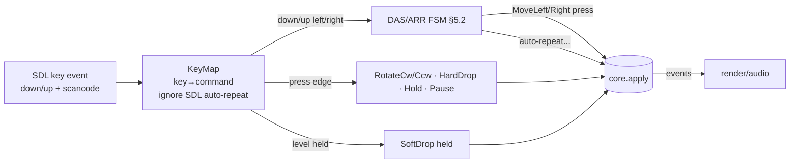

# Flow 04 — Input Flow

Keyboard → `GameCommand`. Guideline §4/§4.1/§5.2. See [04-controls](../04-controls.md).



## Edge vs level vs repeat

- **Discrete (press edge only):** Rotate CW/CCW, Hard Drop, Hold, Pause. No auto-
  repeat (§5.3/§5.4/§5.6); ignore SDL `repeat` flag.
- **Level (while held):** Soft Drop (§5.5); releasing restores normal speed.
- **Movement left/right:** custom **DAS/ARR**, NOT SDL repeat (§5.2). 

## DAS/ARR state machine (§5.2) — `input::das`

State per direction `{ Left, Right }` + `idle`:

```
on press(dir):
   emit Move(dir) once immediately         // tap = one cell
   if other dir held: cancel other; (we are now on `dir`)
   state = Charging(dir); timer = DAS(300ms); 
on tick(dt): 
   if state==Charging && timer<=0: state=Repeating(dir); timer=ARR
   if state==Repeating: every ARR emit Move(dir);   // continue across lock-down (§5.2)
on release(dir):
   if state.dir==dir:
      if other dir still held: state=Charging(other); timer=DAS   // resume other, fresh DAS (§5.2)
      else state=idle
opposite press while repeating:
   emit Move(opposite); cancel current; state=Charging(opposite); timer=DAS   // §5.2
```

- **DAS=300 ms; ARR≈33.3 ms** (10 cells/0.5 s after DAS) (§5.2). Repeats continue to
  **next piece** while held (§5.2, §5.5). Movement while resting resets lock per
  ruleset (§5.7–5.9). 
- Failed moves at walls: no-op + `MoveFailed` event (for SFX §13.2); doesn't break
  DAS repeating; doesn't reset lock (only successful changes count).

## Rotation

Single `RotateCw`/`RotateCcw` per press; core runs SRS kicks; `RotationFailed`
event if none; no auto-repeat; allowed while auto-repeating (§5.3); resets lock per
ruleset on success.

## Hold

Single press; core enforces once-per-lock; `HoldUsed` event; disabled if Hold off.

## Pause

Toggle on press; stops everything; hides matrix/next/hold (§13.1.6). flows/13.

## Focus / lifecycle

- On `WindowEvent::FocusLost`/`Minimized`: auto-pause; clear all held keys & DAS.
- On `FocusGained`: remain paused; require explicit resume. (No missed releases.)
- On `Quit`: app exits; (no save-scum; persistence flushes high scores/settings.)

## Remapping

`KeyMap` maps SDL `Keycode`→`GameCommand`; conflicts rejected; persisted; reset.
Separate menu-key map. (§4.)

## Commands enum

```
enum GameCommand { MoveLeft, MoveRight, RotateCw, RotateCcw, SoftDrop(bool),
                   HardDrop, Hold, Pause, Resume, ... }
```
