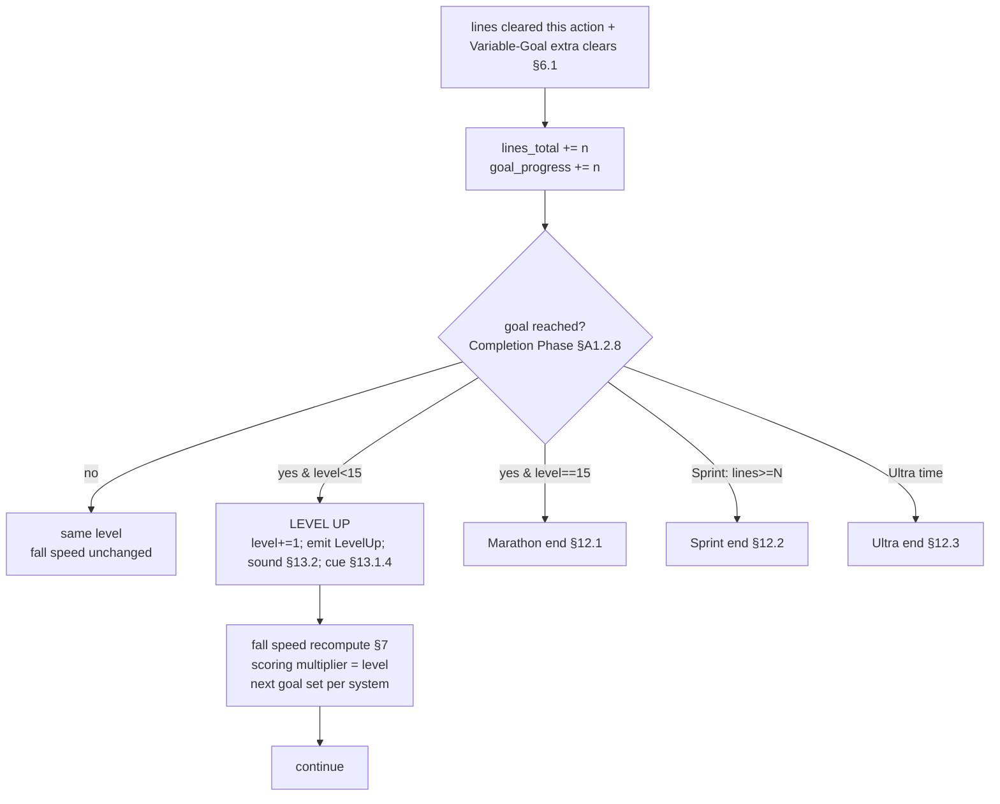

# Flow 10 — Level Progression

§6 levels & goals; §7 speed; §8 scoring level. Completion Phase (A1.2.8).



## Levels (§6, §8)

- Levels **1–15**; default start 1; choose starting level (§2.3.3); score multiplier
  = current level; speed increases with level (§7).
- Level Up when **goal** reached; checked in **Completion Phase** (A1.2.8).
- **Marathon**: 15 levels; ends at 15. **Sprint/Ultra**: no level-up (§12.2/§12.3).

## Goal systems (§6) — engine supports both; **Fixed default v1**

### Fixed Goal (§6)
10 lines/level; 150 total; **starting level L**: goal to next level = total lines
normally cleared before current + current = `10·L` cumulative; per-level goal 10;
e.g. start L4→5 needs 40 (§6). `Goal` display per variant.

### Variable Goal (§6 + §6.1)
level n goal `5·n`; total 600; start level≥2 goal `level·5`; **awarded line clears**
(§6.1 table in [05](../05-scoring-and-progression.md)); B2B `0.5×` total clears; note
fractional `.5` — pin rounding in tests (guideline shows 0.5x; awarded totals integer
at end; implement carefully). 

## Fall speed (§7) → appendix C

```
fall_ms(level) = round( (0.8 - (level-1)·0.007)^(level-1) · 1000 )   clamp >=1
```
Recomputed on level change. Soft drop `/20`. Generated piece falls at normal speed
even while manipulated (§7). `LOCK=500ms`, `GEN=200ms`. 

## Scoring level
`points = base · level` recomputed per action with current level; B2B `0.5×`. Drops
not scaled. (§8.) Starting higher level ⇒ more points (§6 note).

## Progression outputs
`LevelUp` event; HUD level/goal; speed update; (Variant end.) Stats.
