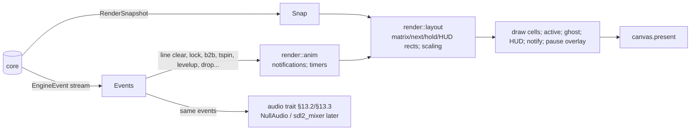

# Flow 12 — Rendering

SDL2; render pure snapshot; animation separate; events→audio seam. §2.4/§13.

## Snapshot → draw

- `render` reads immutable `RenderSnapshot` (02-architecture). No mutation, no logic.
- **Matrix**: 40×10 cells; draw visible 20 rows (+ optional buffer hint + skyline);
  locked blocks darkened; `clearing_rows` for animation; empty cells. 
- **Active piece** cells + **ghost** (landing, translucent/outline; §2.4.4); piece
  color (§3.1); lock flash on commit (§13.1.3).
- **Next** (1–6, North, top-right §2.4.3) + **Hold** (North, top-left §2.4.8).
- **HUD** fields §2.4.7. **Notifications** §13.1.5. **Pause** overlay §13.1.6.

## Animation (§13.1; cosmetic; Animate Phase A1.2.6; doesn't affect logic)

- **Line clear**: effect; intensity ∝ count; (§13.1.1). 
- **Hard-drop trail**: translucent path (§13.1.2). 
- **Lock down**: texture/darken/flash; locked vs in-play (§13.1.3). 
- **Background**: non-interfering; cue level-up & Tetris/T-Spin/B2B (§13.1.4). 
- **Action notifications**: name; quick; **inside matrix ≤L10, outside after** (§13.1.5).
- Smooth inter-cell movement; pieces snap on completion (§5.1); fixed-step + optional
  interpolation (flows/03); still correct with no animation.

## Events → FX/audio mapping (examples)

`Rotated→sfx`, `Moved→sfx`, `MoveFailed→sfx`, `RotationFailed→sfx`,
`Landing→sfx`, `LockedDown→flash+sfx`, `LinesCleared→FX+sfx`, `Scored→notify`,
`TSpin→notify+sfx`, `LevelUp→cue+sfx`, `HoldUsed→sfx`, `GameOver→sfx`, hard/soft
drop→sfx. (§13.1/§13.2.) Animation timers in render; never gate logic.

## Layout & scaling

Integer cell; letterbox; `layout` computes rects; responsive resize; no asset
background v1; **monochrome patterns** fallback §3.2; not relying on color. 
**Pause hides matrix/next/hold** + "Pause" (§13.1.6). (flows/13.)

## Colors (§3.1)
O yellow; I light blue; T purple; L orange; J dark blue; S green; Z red. No protected
artwork shipped.

## Audio trait (§13.2/§13.3) [later]
`trait Audio { fn play(&mut self, ev) }`; `NullAudio`; `SdlAudio` (sdl2_mixer);
Korobeiniki slot; toggle/volume. Not blocking core. 
