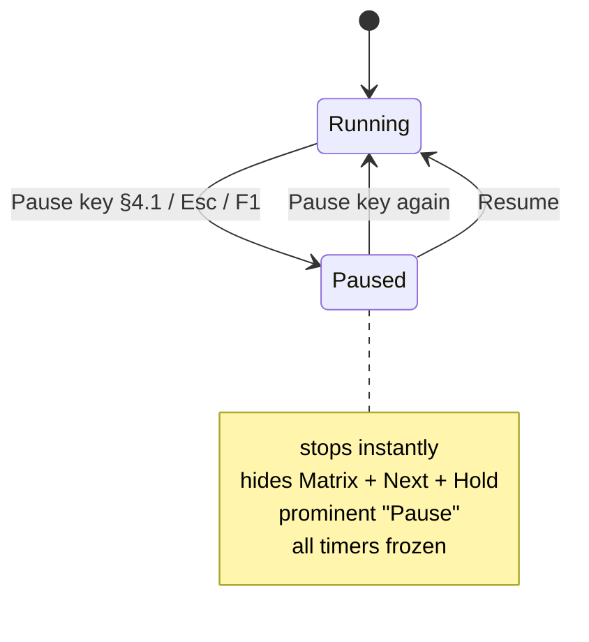

# Flow 13 — Pause

§13.1.6 + §4.1 (Pause key). 

## Behavior (§13.1.6)

- **Instant** stop. 
- **Hide** Matrix, Next Queue, Hold Queue contents. 
- Prominent **"Pause"** on screen. 
- Toggle: press again → resume. 

## Timer handling

Paused ⇒ no `core.tick`, no gravity, no lock-down countdown, no generation delay, no
DAS/ARR progress, no variant clock (Ultra), no animation advance. On resume, no
catch-up burst (accumulator cleared; held keys re-synced). (flows/03/04.)

## Input while paused

Only Resume / quit / (later) menu. Movement/rotation/drop/hold ignored. Pause key
toggles. 

## Focus loss (flows/04)

Auto-pause on `FocusLost`/`Minimized`; clear held keys; require explicit resume. 

## Pausing key
§4.1: Pause = Start/Select (joystick), **Escape/F1** (keyboard), etc.; remappable.
Our default: **Esc** + **F1**. 
