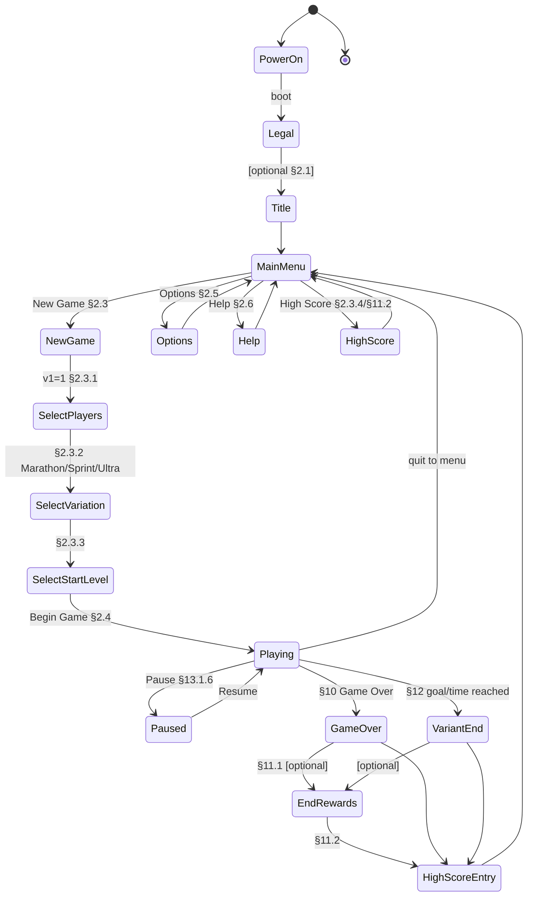

# Flow 14 — Application State Machine

Screens/states around the pure engine. §2 + §11 + §12. Engine itself has its own
phase machine (flows/02).

## States

`PowerOn → Legal → Title → MainMenu → {NewGame(SelectPlayers→SelectVariation→
SelectStartLevel)→Playing | Options | Help | HighScore} → Playing ⇄ Paused →
{GameOver|VariantEnd} → {EndRewards→}HighScoreEntry → MainMenu`. 

Plus in-game transient engine phases inside **Playing** (flows/02), independent of
app screens. **Paused** only reachable from Playing. 

## Notes
- **Playing** delegates to pure `core::TetrisEngine`; app routes commands & renders
  snapshot. 
- **Legal** (§2.1) + **Title logo** (§2.2) required for *licensed* release; optional
  simplified for learning. 
- **HighScoreEntry** then **MainMenu**; table persisted (§11.2). 
- v1 simplifies SelectPlayers=1; keeps structure for later multiplayer (Appendix B).

## Phase-5 additions (implemented)

States added to flows/14 `AppState`: **KeyMap** (key remapping capture; §4.1),
**Help** (§2.6 + scoring demo + credits), **NameEntry** (§11.2 high-score name
entry; on qualify after GameOver-finish), **Demo** (attract mode). 
GameOver → (NameEntry if qualifies) → GameOver. Options extended (sound volume/
toggles, seed, remap). Pause auto on focus-loss. Sound (§13.2/§13.3) is
presentation-only, driven by `core` `EngineEvent`s; `core` stays pure.
Replay recorded (`tehtrys_replay.txt`); deterministic restart (same seed).
